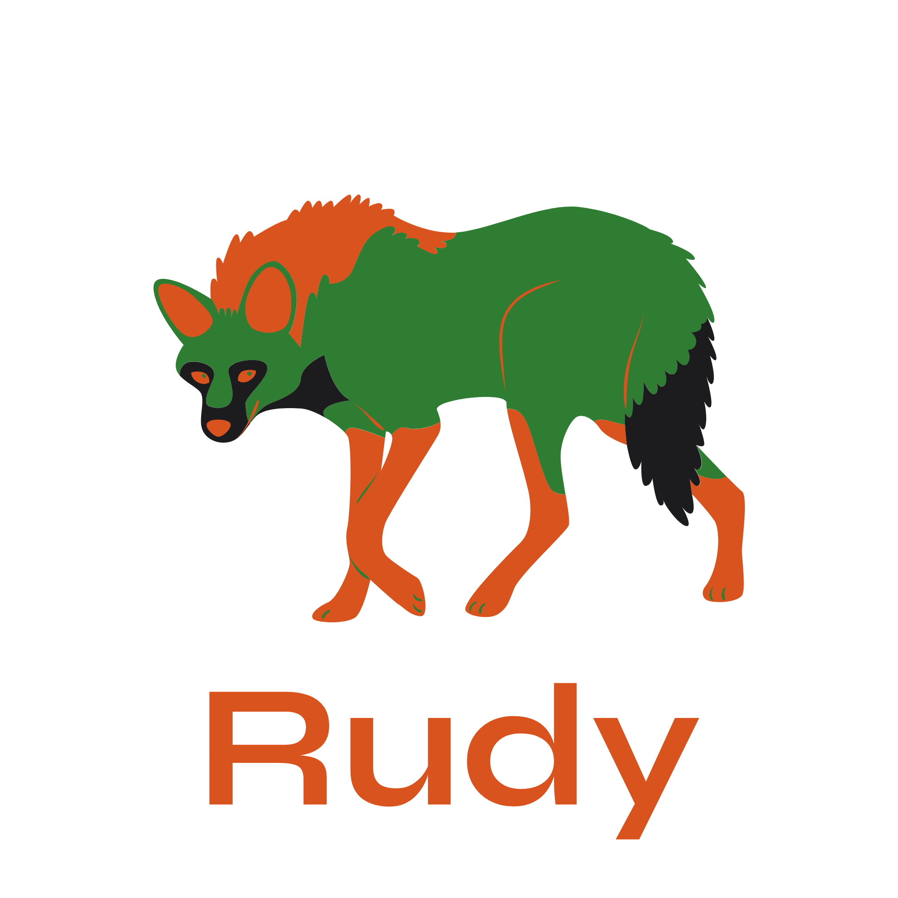

<div align="center">
  

  # 🐺 Rudy
  **A versatile, bilingual, cross-platform programming language inspired by the Maned Wolf.**

  [](https://opensource.org/licenses/Apache-2.0)
  [](https://www.python.org/)
  []()
  [](editors/neovim)
  []()
</div>

---

## 🌟 About Rudy

**Rudy** is a lightweight, multipurpose programming language designed to unite **panoramic readability**, **cross-platform portability** (Desktop PC & Termux/Android), and **complete flexibility**. Inspired by the **Maned Wolf** (*Chrysocyon brachyurus*), Rudy empowers developers to build terminal games, ASCII animations, CLI utilities, and system scripts without boilerplate code.

* **🌍 Native Bilingual Syntax (EN / PT):** Write code seamlessly using English keywords (`action`, `write`, `while`, `if`, `else`, `ask`) or Portuguese keywords (`acao`, `escrever`, `enquanto`, `se`, `senao`, `ler`).
* **🧠 AST-Powered Interpreter:** Built on a clean Lexer, Abstract Syntax Tree (AST) Parser, and Runtime Engine with built-in execution benchmarking.
* **📦 Built-in Package Manager (`rudy install`):** Download and import reusable `.rudy` libraries directly into your `stdlib/` folder via package name or URL.
* **⚙️ Standalone Executable Compiler (`--build`):** Package any `.rudy` script into a standalone `.exe` binary using PyInstaller integration.
* **🎨 Official Neovim Integration:** Includes syntax highlighting, filetype detection, and Tree-sitter queries in `editors/neovim/`.

---

## 💻 Bilingual Code Example

You can write the exact same logic in **English** or **Portuguese** (`.rudy` extension):

<table>
<tr>
<th>🇺🇸 English Syntax</th>
<th>🇧🇷 Sintaxe em Português</th>
</tr>
<tr>
<td>

```rudy
// Interactive adventure in Rudy
action main() {
    write("=== WELCOME TO RUDY ===")
    name = ask("Character name: ")
    hp = 50
    
    damage = random(10, 25)
    hp = hp - damage
    write(name + " took " + damage + " damage!")

    if (hp > 25) then {
        write("Status: Still strong!")
    } else {
        write("Status: Warning! Low HP!")
    }
}
```

</td>
<td>

```rudy
// Aventura interativa na Rudy
acao main() {
    escrever("=== BEM-VINDO À RUDY ===")
    nome = ler("Nome do personagem: ")
    hp = 50
    
    dano = aleatorio(10, 25)
    hp = hp - dano
    escrever(nome + " sofreu " + dano + " de dano!")

    se (hp > 25) entao {
        escrever("Status: Ainda está forte!")
    } senao {
        escrever("Status: Alerta! HP baixo!")
    }
}
```

</td>
</tr>
</table>

---

## 🛠️ Core Features & Standard Library

| Category | English Syntax | Portuguese Syntax | Description |
| :--- | :--- | :--- | :--- |
| **Structure** | `action main() { ... }` | `acao main() { ... }` | Defines an executable block/function |
| **Imports** | `use <module>` | `usar <modulo>` | Imports packages from `stdlib/` |
| **I/O** | `write(...)` / `ask(...)` | `escrever(...)` / `ler(...)` | Prints output and reads user input |
| **Control Flow** | `if (...) then { ... } else { ... }` | `se (...) entao { ... } senao { ... }` | Conditional branching |
| **Loops** | `while (...) { ... }` | `enquanto (...) { ... }` | Conditional loop execution |
| **Math & RNG** | `random(min, max)` / `+ - * /` | `aleatorio(min, max)` / `+ - * /` | Random integers and arithmetic |
| **Terminal** | `sleep(sec)` / `clear()` | `pausar(sec)` / `limpar()` | Frame timing and screen clearing |
| **File System** | `save(path, data)` / `load(path)` | `salvar(path, data)` / `carregar(path)` | Read and write local files |

---

## 📁 Project Structure

```text
Rudy/
├── assets/          # Official logos, icons, and brand assets
├── editors/
│   └── neovim/      # Official Neovim plugin (Lua, Vimscript, Tree-sitter queries)
├── examples/        # Sample .rudy scripts, games (Snake, Masmorra), and demos
├── src/
│   └── rudy.py      # Lexer, AST Parser, Runtime Engine, Package Manager & Compiler
├── stdlib/          # Standard Library & installed packages
├── LICENSE          # Apache 2.0 License
└── README.md        # Main project documentation
```

## 🚀 Getting Started

### 1. Clone the Repository
```bash
git clone https://github.com/luispolis124/Rudy.git
cd Rudy
```

### 2. Run a Rudy Script
Make sure **Python 3** is installed, then execute any `.rudy` file:
```bash
python src/rudy.py examples/masmorra.rudy
```

### 3. Install Packages (`stdlib/`)
```bash
python src/rudy.py install <package_name_or_url>
```

### 4. Compile to Standalone Executable (`.exe`)
```bash
python src/rudy.py examples/masmorra.rudy --build
```

### 5. Enable Neovim Syntax Highlighting
Check the setup guide inside [`editors/neovim/README.md`](editors/neovim/README.md) to activate `.rudy` syntax colors in Neovim (Linux, macOS, or Termux).

---

## 🤝 How to Contribute

Contributions, new stdlib modules, game examples, and editor plugins are always welcome!

1. Fork the project
2. Create your feature branch (`git checkout -b feature/AmazingFeature`)
3. Commit your changes (`git commit -m 'Add some AmazingFeature'`)
4. Push to the branch (`git push origin feature/AmazingFeature`)
5. Open a **Pull Request** or **Issue** (and don't forget to give the repo a ⭐!)

---

## 📜 License

This project is licensed under the **Apache License 2.0**. See the [LICENSE](LICENSE) file for more details.

---

<div align="center">
  Made with dedication in Brazil 🇧🇷 by <b>Luis Felipe</b>
</div>
